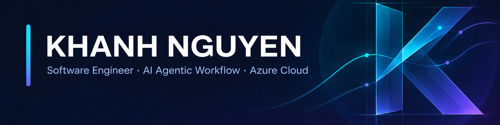

  

<h1 align="center">I build software for people doing difficult work.</h1>

  I turn complex workflows into useful, reliable applications — from full-stack products to agentic AI and Azure solutions.

 

  

  &nbsp;&nbsp;
  &nbsp;&nbsp;
  &nbsp;&nbsp;
  &nbsp;&nbsp;
  

  <strong>React · C# · Vue · Next.js · Node.js · Azure · Python</strong> 
  <strong>SQL Server · PostgreSQL · Codex · Claude · GitHub Copilot</strong>

 

<h2 align="center">Certifications</h2>

<table align="center">
  <tr>
    <td align="center" width="50%">
       
      <strong>AZ-204</strong> Azure Developer Associate
    </td>
    <td align="center" width="50%">
       
      <strong>AI-103</strong> Azure AI Apps and Agents Developer Associate
    </td>
  </tr>
  <tr>
    <td align="center">
       
      <strong>PL-400</strong> Power Platform Developer Associate
    </td>
    <td align="center">
       
      <strong>AB-100</strong> Agentic AI Business Solutions Architect Expert
    </td>
  </tr>
  <tr>
    <td align="center" colspan="2">
       
      <strong>AB-731</strong> AI Transformation Leader
    </td>
  </tr>
</table>
