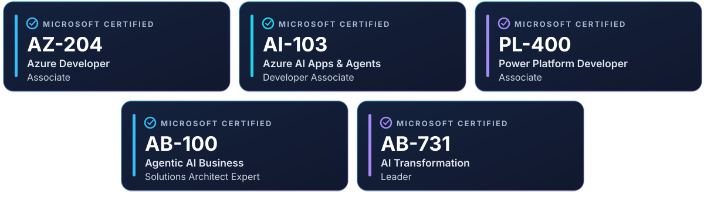

  

<h1 align="center">I build software for people doing difficult work.</h1>

  I turn complex workflows into useful, reliable applications — from full-stack products to agentic AI and Azure solutions.

 

<h2 align="center">Tech stack</h2>

  

<strong>React · C# · Vue · Next.js · Node.js · Azure</strong>

 

<h2 align="center">Certifications</h2>

  

